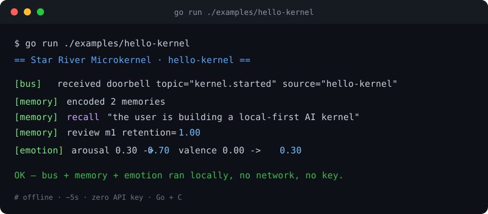

# Star River Microkernel

[](https://github.com/cjintao133-cell/star-river/actions/workflows/ci.yml)
[](https://pkg.go.dev/github.com/cjintao133-cell/star-river)
[](LICENSE)
[](go.mod)
[](https://www.bestpractices.dev/projects/16960)
[](https://scorecard.dev/viewer/?uri=github.com/cjintao133-cell/star-river)



**Drop an AI brain into your Go app — no Python, no 2 GB image, no leaky abstractions.**

> **An embeddable AI-assistant kernel** — pure Go (a sliver of C only for the optional SIMD vector index),
> for Android, Windows, Linux and edge. It packages context assembly, memory, emotion, proactivity,
> tools/MCP, multimodal adapters and encrypted local storage into a kernel you import into your own app.
> **Inference is BYOK** (cloud or local models). No backend of ours, no telemetry.
>
> **It does not run model weights — it owns the layer *around* the model, *inside* your app.**
> Memory / emotion / proactivity are pluggable capabilities, not its definition.

```
Production code: 19,562 LOC · 32 packages · tests: 16,407 LOC
Direct dependency: 1 (modernc.org/sqlite, pure Go) · License: Apache-2.0
Single static binary: ~6.7 MB (linux/amd64 -ldflags "-s -w"; 6.25 MB arm64), CGO_ENABLED=0
```

> **Status**: this repo focuses on the **core / framework**. The Android & desktop **UI has been moved out of
> the main tree** (reference implementation, WIP); retrieve it via the `with-ui` branch or `pre-ui-strip` tag.
> Please evaluate the project by its **kernel architecture / protocols / data security**.

> Docs: [Product](./docs/product-brief.md) · [Features](./docs/features.md) · [Usage](./docs/usage.md) · [FAQ](./docs/faq.md) · [Troubleshooting](./docs/troubleshooting.md) — 中文文档见 [README.zh.md](./README.zh.md) / `docs/*.zh.md`

Star River Microkernel is an **embeddable AI-assistant kernel**: a general core + pluggable "capability
plugin" packs (Ebbinghaus memory / five-dimensional emotion / proactive scheduling). The core stays clean,
compiles on its own, and is open source; persona and emotional behavior live in plugins, not in the kernel's identity.

## See it work (offline, ~5 seconds, no key)

```sh
go run ./examples/hello-kernel
```
It runs the core loop locally — event bus → memory (forgetting-curve recall) → emotion (5-D state):
```
[bus]      received doorbell  topic="kernel.started" source="hello-kernel"
[memory]   recall   "the user is building a local-first AI kernel"  score=1.53 retention=1.00
[emotion]  arousal 0.30 -> 0.70   valence 0.00 -> 0.30
```

## Architecture


```
        ┌────────────────────────── App layer (UI) ─────────────────────────┐
        │   Android: Kotlin Compose      Windows: Compose Multiplatform      │
        └───────────────▲───────────────────────────────▲──────────────────┘
                        │ gomobile AAR / c-shared DLL + JNI
        ┌───────────────┴───────────────────────────────┴──────────────────┐
        │                    Go kernel (star-river-kernel)                  │
        │  core/types  core/clock  bus   adapter(openai/anthropic/gemini)  │
        │  orchestrator(7-layer context)  store(SQLite WAL+AES-GCM)        │
        │  tool(remote/stdio MCP + builtins)  cards(character cards)       │
        │  ────────────── capability plugins (pluggable) ──────────────    │
        │  hippocampus(memory)  endocrine(emotion)  proactive(scheduler)   │
        └───────────────▲──────────────────────────────────────────────────┘
                        │ cgo
        ┌───────────────┴───────────────┐
        │  C hot paths: device_probe / vector search (int8·NEON)  │
        └────────────────────────────────┘
```

- **Communication**: commands/queries go through direct interface calls; state changes go through the `bus`
  doorbell broadcast (subscribers pull the latest snapshot, tolerate dropped bells, bounded-buffer backpressure).
- **Layering constraint (dependency direction)**: core packages **must not** import capability-plugin packages;
  plugins may import the core. Enforced by `scripts/check-open-split.sh` (the core compiles standalone).

## Repository layout

```
star-river/
  kernel/       Go kernel
    core/{types,clock}  bus  adapter/  orchestrator/  store/  secret/
    cards/  tool/  tooldisc/  visual/  voice/  search/  backup/  diag/  compliance/  i18n/  netx/
    native/{bridge,vector}  mobilebind/  desktopbind/
    hippocampus/ endocrine/ proactive/        capability plugins
  native/       C modules (device_probe, vector search)
  cmd/srchat/       minimal CLI chat loop
  cmd/livecheck/    real-endpoint smoke tests
  cmd/stresssim/    year-scale stress simulation
  docs/             product/usage/faq/features/troubleshooting/architecture/licensing/privacy (see docs/README.md)
  scripts/          build & guard scripts
```

## Quick start

Prerequisites: **Go 1.26.11+** (see `go.mod`), a C toolchain; for Android also NDK r26+/JDK17/Gradle 8.9.

```sh
# Full gate (build / vet / race tests)
go build ./...
go vet ./...
staticcheck ./...
go test -race ./...

# Layering guard (core must not depend on capability plugins)
sh scripts/check-open-split.sh

# Minimal CLI chat (key only via -keyfile or SR_API_KEY; never in argv/logs)
go run ./cmd/srchat -base https://host/v1 -model <model> -keyfile /path/to/key
```

Build artifacts: Android `gomobile bind` → AAR; Windows/desktop `-buildmode=c-shared` → DLL + JNI bridge.

## Character cards

Four carriers are supported (`kernel/cards`):

- **V2 / V3 JSON**: `spec` or `spec_v2` + `data` nested structure.
- **chara PNG**: base64 card JSON embedded in PNG `tEXt`/`iTXt` chunks (`ccv3` preferred over `chara`).
- **charx**: `card.json` inside a zip (falls back to any json).
- World-book entries support keyword activation (`Constant` always-on + keyword activation, depth cap + loop detection).

## Dependency policy

Nothing outside the `docs/architecture.md` dependency list may be introduced. Current deps only:
standard library first; `modernc.org/sqlite` (pure-Go SQLite, no cgo); `golang.org/x/mobile` (build chain).
No third-party SDKs; agent protocols (OpenAI/Anthropic/Gemini/MCP) are hand-written.

## Contributing

- Per-commit gate: clean `gofmt` + `go vet` + `staticcheck` + relevant unit tests (concurrent packages with `-race`);
  core-package coverage ≥70%; C code passes ASan+Valgrind with zero reports.
- The red lines in `docs/architecture.md` are non-negotiable, especially dependency direction (core does not import
  capability plugins) and keys never appearing in logs/URLs.
- Security-sensitive code (crypto, cgo handles, signature chain) is tagged `REVIEW-NEEDED` and requires external review before release.

## License

- **Whole repo under Apache-2.0** (see `LICENSE` / `docs/licensing.md`), including all kernel packages and the
  memory/emotion/proactivity capability plugins.

## Status

Kernel in development (open items and on-device-unverified items in `KNOWN-ISSUES.md`; doc index in `docs/README.md`).
UI polish and on-device acceptance are handled together in a later phase.
